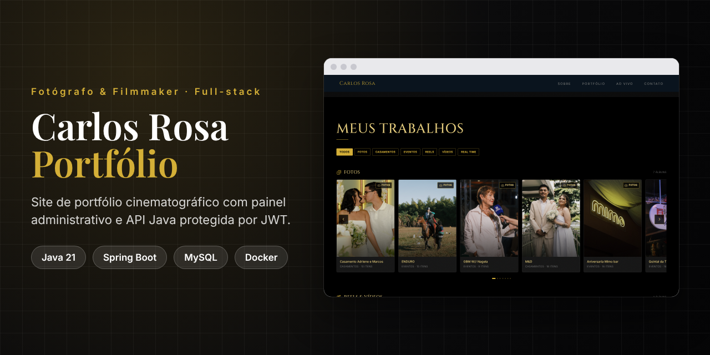
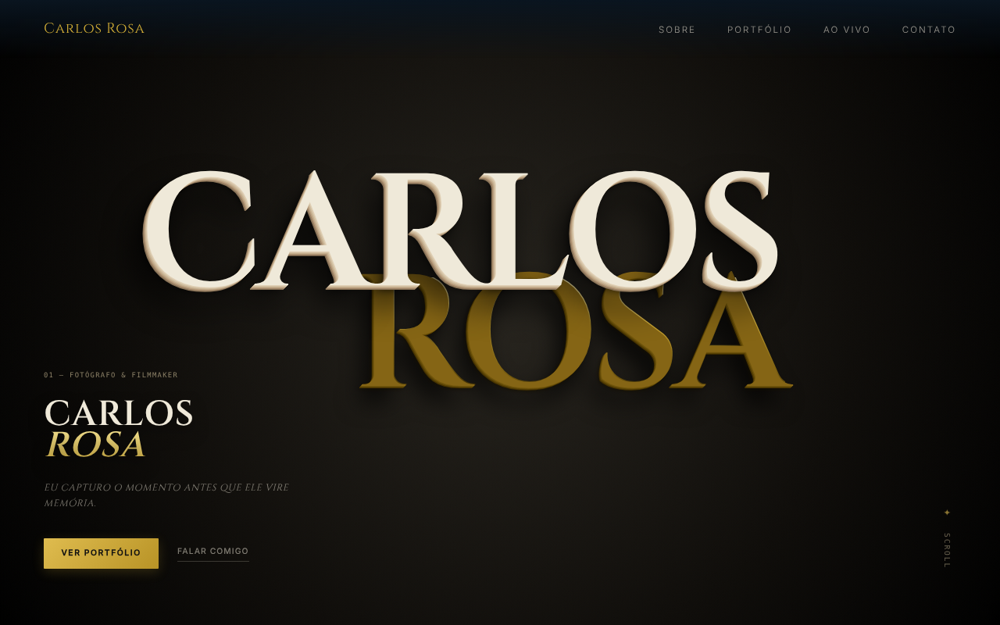
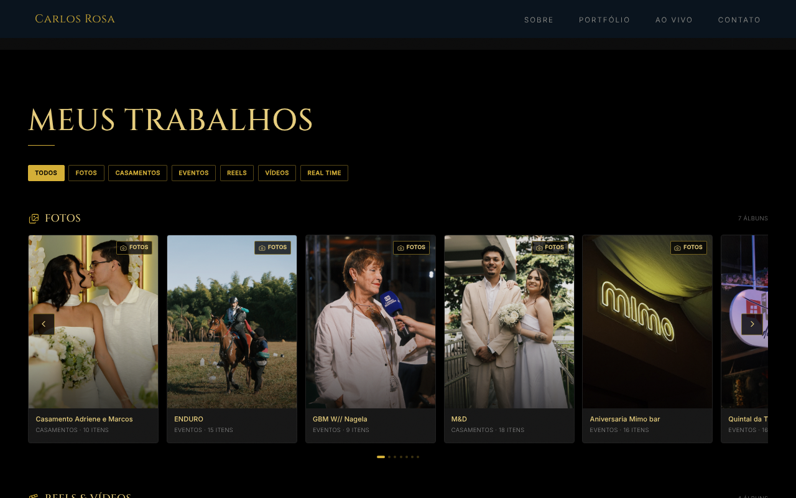
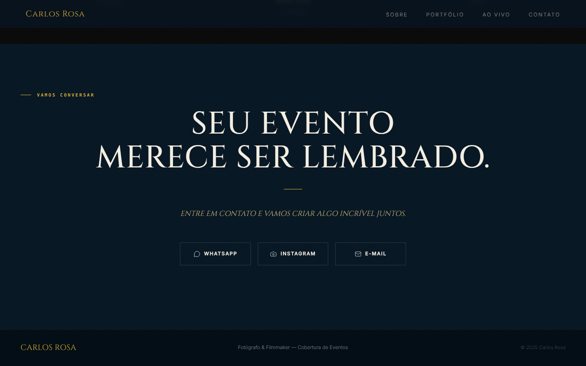
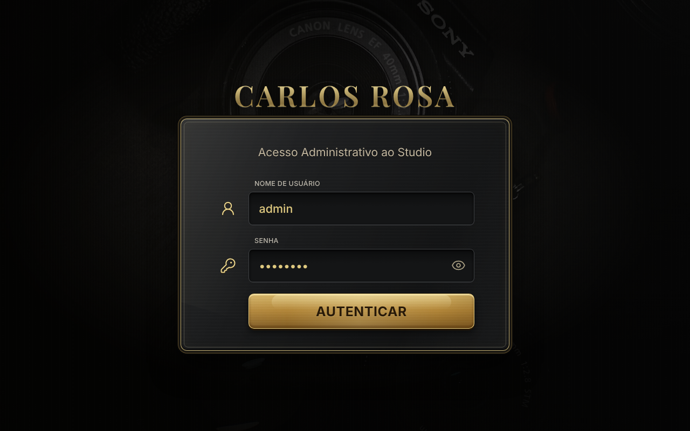
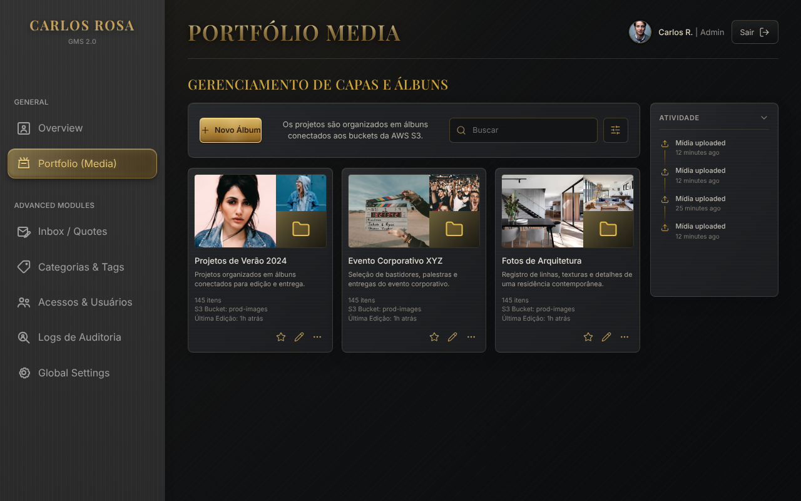
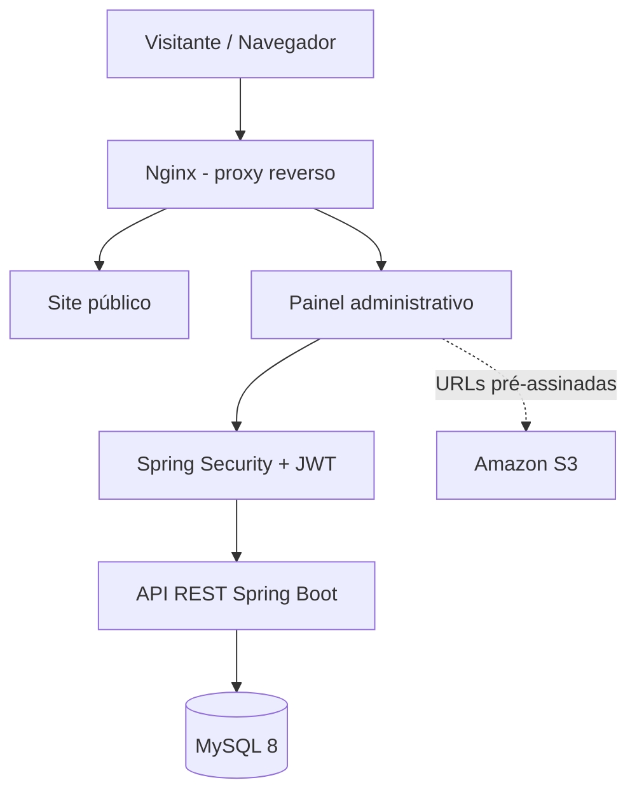

<p align="center">
  
</p>

<h1 align="center">🎬 Carlos Rosa — Plataforma Digital de Portfólio</h1>

<p align="center">
  Plataforma full-stack feita sob medida para um <b>fotógrafo e filmmaker</b>: site público com visual
  <b>Dark Luxury</b>, painel administrativo (CMS) e <b>API REST em Java/Spring Boot</b> protegida por <b>JWT</b>,
  tudo orquestrado com <b>Docker Compose</b>.
</p>

<p align="center">
  
  
  
  
  
  
  
  
  
</p>

<p align="center">
  <a href="#-sobre-o-projeto">Sobre</a> •
  <a href="#-funcionalidades">Funcionalidades</a> •
  <a href="#%EF%B8%8F-telas">Telas</a> •
  <a href="#%EF%B8%8F-arquitetura">Arquitetura</a> •
  <a href="#-api-rest">API</a> •
  <a href="#-como-executar">Como executar</a> •
  <a href="#-estrutura-do-projeto">Estrutura</a> •
  <a href="#%EF%B8%8F-tecnologias">Tecnologias</a>
</p>

---

## 📌 Sobre o projeto

> *“A tecnologia deve amplificar a fotografia, nunca competir com ela.”*

Plataforma digital (monorepo) projetada para o fotógrafo e filmmaker **Carlos Rosa**, especializado em cobertura de
eventos, casamentos e conteúdo em tempo real. O projeto reúne três partes:

- **Site público** — vitrine cinematográfica em HTML, CSS e JavaScript puros, com paleta de pretos profundos e
  acentos em ouro velho, título 3D feito com CSS (sem WebGL) e portfólio em carrossel com fotos do Google Drive e
  vídeos do YouTube.
- **Painel administrativo (CMS)** — tela de login e dashboard com módulos de portfólio, orçamentos (inbox),
  categorias, usuários, logs de auditoria e configurações globais.
- **API REST** — Java 21 + Spring Boot 3, organizada em `controllers`, `services`, `dtos`, `entities` e
  `repositories`, com autenticação JWT, controle de acesso por papéis (RBAC) e geração de URLs pré-assinadas do S3.

## ✨ Funcionalidades

| | Recurso | Descrição |
|---|---|---|
| 🎞️ | **Hero cinematográfico** | Nome em camadas 3D feitas só com CSS, tipografia *Cinzel* + *Inter* |
| 🗂️ | **Portfólio com filtros** | Álbuns em carrossel filtrados por Fotos, Casamentos, Eventos, Reels, Vídeos e Real Time |
| 🖼️ | **Visualizador de álbum** | Modal com navegação entre fotos (Google Drive) e vídeos/Shorts (YouTube) |
| 📡 | **Cobertura ao vivo** | Seção que apresenta a entrega de fotos e vídeos durante o evento |
| 💬 | **Depoimentos e contato** | Depoimentos de clientes e botões de WhatsApp, Instagram e e-mail |
| ✏️ | **Editor embutido no site** | Painel oculto para editar álbuns, depoimentos e contatos, salvo no `localStorage`, com exportação dos dados e do HTML |
| 🔐 | **Login JWT** | `POST /api/v1/auth/login` devolve o token usado pelo painel administrativo |
| 👥 | **Usuários e papéis** | Papéis `ADMIN`, `EDITOR` e `VIEWER`; rotas protegidas com `@PreAuthorize` |
| 📨 | **Orçamentos (booking)** | Registro de pedidos de orçamento e alteração de status pelo admin |
| 🧾 | **Auditoria** | Endpoint de leitura dos logs de auditoria, restrito ao `ADMIN` |
| ☁️ | **Upload direto no S3** | A API gera URL pré-assinada e o arquivo vai direto para o bucket, sem passar pelo servidor |
| 🐳 | **Ambiente em containers** | MySQL, backend e Nginx sobem juntos com Docker Compose |

> ℹ️ O site público funciona sozinho (dados iniciais em `frontend/public/main.js` + `localStorage`) e ainda não
> consome a API. No painel administrativo, as telas de usuários e auditoria buscam dados da API; as demais mostram
> o layout com dados de exemplo.

## 🖼️ Telas

<table>
  <tr>
    <td align="center"><b>Página inicial</b><br></td>
    <td align="center"><b>Portfólio</b><br></td>
  </tr>
  <tr>
    <td align="center"><b>Contato</b><br></td>
    <td align="center"><b>Login do painel</b><br></td>
  </tr>
  <tr>
    <td align="center"><b>Painel administrativo (layout)</b><br></td>
    <td align="center"><b>Celular</b><br></td>
  </tr>
</table>

## 🏗️ Arquitetura

O código separa apresentação, orquestração e armazenamento de mídia.



- **Nginx** (`infrastructure/nginx/default.conf`): serve o site em `/`, o painel em `/admin` e encaminha `/api/`
  para o backend.
- **Backend** (`backend/`): build em duas etapas no `Dockerfile` (Maven → JRE 21).
- **Banco** (`database/migrations/`): a migração Flyway `V1__Create_Initial_Schema.sql` cria as tabelas de usuários,
  papéis, refresh tokens, portfólio, mídia, eventos ao vivo, depoimentos e auditoria, e cadastra os papéis
  `ADMIN`, `EDITOR` e `VIEWER`.

### 🔒 Segurança

- **API stateless com JWT**: rotas administrativas exigem `Authorization: Bearer <token>`, validado pelo filtro
  `JwtAuthTokenFilter`.
- **RBAC**: permissões por endpoint com `@PreAuthorize` (ex.: `hasAnyRole('ADMIN', 'EDITOR')`).
- **Senhas com BCrypt** e segredos (`JWT_SECRET`, chaves da AWS) lidos de variáveis de ambiente.
- **Upload por URL pré-assinada**: arquivos grandes não passam pela API.
- **Sem stack trace na resposta**: `server.error.include-stacktrace: never`.

Mais detalhes em [`docs/ETAPA-8_SECURITY.md`](docs/ETAPA-8_SECURITY.md), no fluxo de UX em
[`docs/ETAPA-3_UX_UI.md`](docs/ETAPA-3_UX_UI.md) e nas notas de correção do deploy em
[`docs/DEPLOYMENT_FIXED.md`](docs/DEPLOYMENT_FIXED.md).

## 🔌 API REST

Base: `/api/v1`

| Método | Rota | Acesso |
|---|---|---|
| `POST` | `/auth/login` | Público |
| `GET` | `/portfolio`, `/portfolio/{slug}` | Público |
| `POST` | `/portfolio` | ADMIN, EDITOR |
| `GET` | `/categories` | Autenticado |
| `POST` | `/categories` | ADMIN, EDITOR |
| `DELETE` | `/categories/{id}` | ADMIN |
| `GET` | `/bookings` | ADMIN, EDITOR |
| `POST` | `/bookings` | Autenticado |
| `PUT` | `/bookings/{id}/status` | ADMIN |
| `GET` / `POST` | `/users` | ADMIN |
| `DELETE` | `/users/{id}` | ADMIN |
| `GET` | `/audit` | ADMIN |
| `GET` | `/settings` | Autenticado |
| `POST` | `/settings` | ADMIN |
| `GET` | `/media/presigned-url` | ADMIN, EDITOR |

## 🚀 Como executar

### Com Docker Compose (ambiente completo)

Pré-requisito: [Docker Desktop](https://www.docker.com/products/docker-desktop/) em execução.

1. Crie um arquivo `.env` na raiz com as variáveis lidas pelo `docker-compose.yml`:

   ```env
   DB_PASSWORD=troque-esta-senha
   JWT_SECRET=uma-chave-longa-com-pelo-menos-256-bits
   S3_BUCKET_NAME=nome-do-bucket
   AWS_ACCESS_KEY_ID=...
   AWS_SECRET_ACCESS_KEY=...
   ```

2. Suba os containers:

   ```bash
   docker compose up -d --build
   ```

| Serviço | Endereço |
|---|---|
| 🌐 Site público | http://localhost/ |
| 💼 Painel administrativo | http://localhost/admin/ |
| ⚙️ API Java | http://localhost:8080/api/v1/... |
| 🗄️ MySQL | `localhost:3307` |

Na subida, o Flyway aplica a migração `V1` e o `DatabaseSeeder` cria o usuário administrador inicial. Troque a
senha padrão definida no código antes de publicar.

### Só o backend (Maven)

```bash
cd backend
mvn -DskipTests package
```

O build gera `target/portfolio-backend-0.0.1-SNAPSHOT.jar` (conferido com Java 21 e Maven 3). Para rodar, a API
precisa de um MySQL acessível pelas variáveis `DB_HOST`, `DB_PORT`, `DB_NAME`, `DB_USER` e `DB_PASSWORD`.

### Só o site público

Abra `frontend/public/index.html` no navegador; ele não depende do backend.

## 📁 Estrutura do projeto

```
Carlos-Rosa/
├── backend/
│   ├── Dockerfile                 # Build Maven + imagem JRE 21
│   ├── pom.xml
│   └── src/main/
│       ├── java/com/carlosrosa/portfolio/
│       │   ├── config/            # DatabaseSeeder (admin inicial)
│       │   ├── controllers/       # Auth, Portfolio, Category, Booking, User, Audit, Settings, Media
│       │   ├── dtos/              # LoginRequest, JwtResponse, UserDTO, UserCreateRequest
│       │   ├── entities/          # User, Role, PortfolioProject, Category, BookingRequest, AuditLog, SiteSettings
│       │   ├── repositories/      # Spring Data JPA
│       │   ├── security/          # JWT, filtro e SecurityConfig
│       │   └── services/          # UserService
│       └── resources/application.yml
├── database/
│   └── migrations/V1__Create_Initial_Schema.sql   # Schema Flyway
├── frontend/
│   ├── public/                    # Site: index.html, style.css, main.js
│   └── admin/                     # Painel: login.html, index.html
├── infrastructure/
│   └── nginx/default.conf         # Proxy reverso
├── docs/                          # UX, segurança, notas de deploy, banner e prints
└── docker-compose.yml             # MySQL + backend + Nginx
```

## 🛠️ Tecnologias

- **Java 21** e **Spring Boot 3.2** (Web, Data JPA, Security, Validation)
- **JJWT 0.11** para tokens JWT
- **MySQL 8** com migrações **Flyway**
- **AWS SDK v2 (S3)** para URLs pré-assinadas
- **Lombok**
- **HTML5, CSS3 e JavaScript** sem frameworks, ícones **Lucide** e fontes **Cinzel** e **Inter**
- **Docker Compose** e **Nginx**

## 👨‍💻 Autor

Desenvolvido por **[kauaxp77](https://github.com/kauaxp77)** para o fotógrafo e filmmaker Carlos Rosa.

<p align="center">⭐ Se curtiu o projeto, deixe uma estrela!</p>
